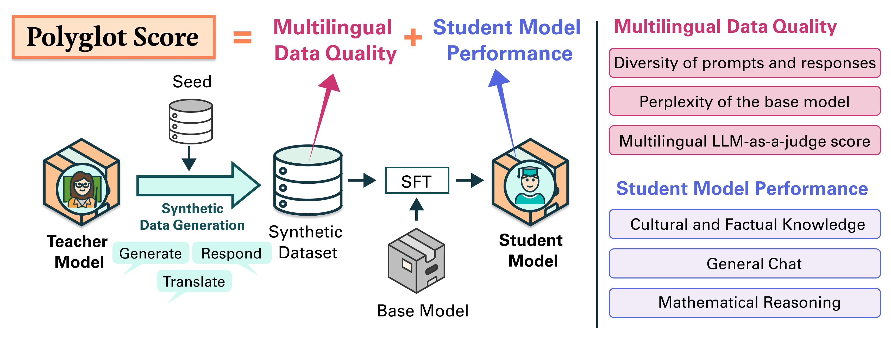

&nbsp;&nbsp;&nbsp;

<!-- # Polyglot Teachers: Evaluating LLMs for Multilingual Synt. Data Generation  -->

# Polyglot Teachers: Evaluating Language Models for Multilingual Synthetic Data Generation

 [[📄 Paper](https://aclanthology.org/2026.emnlp-main.440/)] [[🤗 HuggingFace Collection](https://huggingface.co/collections/ljvmiranda921/polyglot-teachers)] [[🌐 Website](https://ljvmiranda921.github.io/polyglot-teachers/)]

Supervised finetuning (SFT) has been a dominant approach in building multilingual language models (LMs).
Central to its success is the availability of high-quality multilingual datasets.
However, collecting this data from native-speakers demands substantial human effort and resources, creating a bottleneck in LM development.

**Synthetic data generation** has been an appealing alternative to human annotation, in part due to its cost-efficiency (you just need an API call) and scalability (you can generate thousands of examples in a day).
However, research is scarce on how we can leverage the synthetic data pipeline to create high-quality multilingual data.

In this work, we ask the question: **"what makes a good multilingual teacher for synthetic data generation?"**
Specifically, we perform a comprehensive analysis of several language models and evaluate their data quality as teacher models, and the performance gain of the resulting student model on some benchmarks.


<p align="center">

<br/>
<i>Overview of the Polyglot Score and how it fits into the distillation workflow.</i>
</p>

## News

- [2026-08-20] Polyglot Teachers has been accepted to the main track of EMNLP! See you in Budapest!
- [2026-07-14] Check out our new [website](https://ljvmiranda921.github.io/polyglot-teachers/) containing our findings.
- [2026-07-07] We added new human evaluation experiment results in the latest preprint.
- [2026-04-13] Introducing Polyglot Teachers, a research on multilingual synthetic data generation.

## Setup & Installation

Make sure that you have `uv` in your system (see [download instructions](https://docs.astral.sh/uv/getting-started/installation/)).
To install all dependencies, run the following commands: 

```sh
git submodule update --init --recursive --depth 1
uv sync --dev
# When training on TPUs and developing models via tunix
# uv sync --extra tpu
# When doing evaluations via lighteval
# uv sync --extra eval
source .venv/bin/activate
```

Isambard is a bit different because the login node doesn't have a GPU (if you sync normally, it will install the CPU versions of pytorch which will mess up your virtual environment). Instead you should run these commands:

```sh
uv sync \
    --no-install-package triton \
    --no-install-package torch \
    --no-install-package torchaudio \
    --no-install-package torchvision \
    --no-install-package vllm \
    --no-install-package llama-cpp-python \
    --no-install-package ctranslate2 
sbatch experiments/slurm_submit.isambard experiments/jobs/sync_isambard.sh
```

For more information on how to use this codebase, please refer to the [documentation](DOCUMENTATION.md).
For information on running experiments on the cluster, see the [experiment documentation](experiments/README.md).

## Acknowledgements

LJVM and AK acknowledge the support of the UKRI Frontier Grant EP/Y031350/1 ([EQUATE](https://gtr.ukri.org/projects?ref=EP%2FY031350%2F1)).
This work was performed using joint resources provided by the [Cambridge Service for Data Driven Discovery (CSD3)](https://hpc.cam.ac.uk/high-performance-computing) EP/T022159/1, the [Isambard AI National AI Research Resource (AIRR)](https://www.bristol.ac.uk/research/centres/bristol-supercomputing/#isambard-ai) ST/AIRR/I-A-I/1023, and the Microsoft Research Grant.

## Citation

```
@inproceedings{miranda-etal-2026-polyglot,
    title = "Polyglot Teachers: Evaluating Language Models for Multilingual Synthetic Data Generation",
    author = "Miranda, Lester James Validad  and
      Vuli{\'c}, Ivan  and
      Korhonen, Anna",
    editor = "Lee, Hung-Yi  and
      Dev, Sunipa  and
      Li, Jessy  and
      Elliott, Desmond",
    booktitle = "Proceedings of the 2026 Conference on Empirical Methods in Natural Language Processing",
    month = oct,
    year = "2026",
    address = "Budapest, Hungary",
    publisher = "Association for Computational Linguistics",
    url = "https://aclanthology.org/2026.emnlp-main.440/",
    pages = "10116--10144",
    ISBN = "979-8-89176-459-0",
    abstract = "Synthesizing supervised finetuning (SFT) data from language models (LMs) to teach smaller models multilingual tasks has become increasingly common. However, teacher model selection is often ad hoc, typically defaulting to the largest available option, even though such models may have significant capability gaps in non-English languages. This practice can result in poor-quality synthetic data and suboptimal student downstream performance. In this work, we systematically characterize what makes an effective multilingual teacher. We combine intrinsic measures of data quality with extrinsic student model performance in a metric we call Polyglot Score. We evaluate 10 LMs across 6 typologically diverse languages, generating over 1.4M SFT examples and training 240 student models. Our analyses reveal that model scale alone does not significantly predict teacher effectiveness: the most effective teachers we identify are consistently smaller than the largest models evaluated, and their ranking is stable across student base model families. Instead, data qualities such as prompt diversity, length, and response fluency capture 93.3{\%} of the variance in intrinsic data quality and predict student performance. Finally, we provide practical recommendations, including matching the model families of teacher-student pairs and generating responses to existing prompts or translating them from English, which can yield improvements for less-resourced languages. We hope that our work advances data-centric research in multilingual synthetic data and LM development."
}
```
